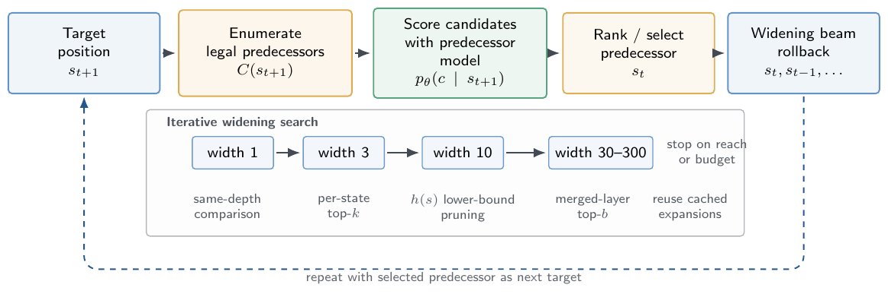
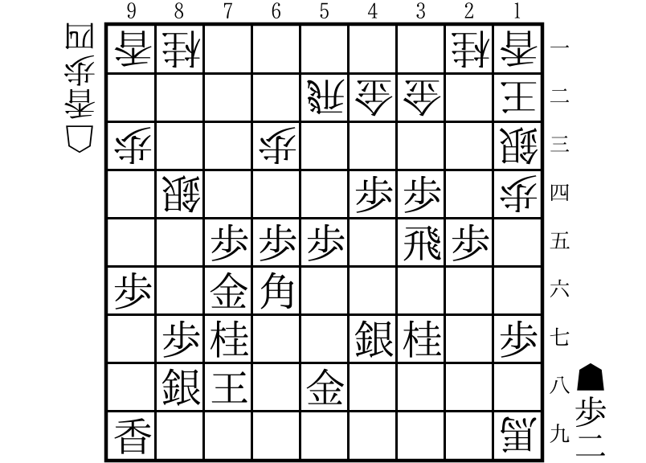

# Shogi History Reconstruction

## Paper

Hiroki Taniai and Hidetsugu Irie. “Reconstructing Plausible Game Histories via
Legal-Projected Reverse Generation: A Shogi Case Study.” In the *Proceedings of
the 22nd AAAI Conference on Artificial Intelligence and Interactive Digital
Entertainment (AIIDE 2026)*, 2026.

See [`CITATION.cff`](CITATION.cff) for machine-readable citation metadata.

Code and artifacts for legal-projected reconstruction of plausible shogi game
histories. Given a target position, the system enumerates legal predecessors,
ranks them with a transformer model, and applies iterative widening beam search
toward the standard initial position.



## Worked example



Starting from the target position above, the decoder reconstructed a fully
legal 80-move history. The search reached the standard initial position after
80 expansions without backtracking.

```text
Generated history (USI, 80 moves):
2g2f 8c8d 7g7f 8d8e 8h7g 3c3d 7i8h 4a3b 3i4h 7a6b 6i7h 3a4b 5i6i 7c7d 9g9f 4b3c 3g3f 2b3a 4i5h 5a4a 5g5f 6a5b 2i3g 5c5d 4g4f 1c1d 2f2e 4c4d 6g6f 8e8f 7g8f 3a8f 8g8f 8b8f P*8g 8f8b 4h4g 6b7c 7h6g 7c6d 6i7h 5d5e 5f5e 6d5e P*5f 5e6d 6f6e 6d7c 8i7g 7c8d 5f5e 7d7e B*6f 7e7f 6g7f 4a3a P*7e 5b4b 3f3e 8b5b 3e3d 3c2b 2e2d 2c2d 2h2d 2b2c 2d2f 3a2b 2f3f B*2h 4f4e 2h1i+ P*2d 2c2d P*2e 2d1c 4e4d P*3e 3f3e 2b1b
```

Replaying the generated moves from the standard initial position produces the
target board, hands, and side to move. The target SFEN, generated history, and
search statistics are available in
[`docs/worked-example.json`](docs/worked-example.json).

## Install

Python is pinned in `.python-version`; dependencies are locked with
[uv](https://docs.astral.sh/uv/).

```bash
uv sync --extra dev
uv run pytest
```

The Python implementation uses [`rsshogi`](https://pypi.org/project/rsshogi/)
for shogi positions, legal moves, and policy labels. The reported multi-step
search uses the fixed-revision YaneuraOu candidate-generation backend:

```bash
bash scripts/setup_yaneuraou.sh
```

## Reconstruct a history

Download the released `final_model.ckpt`, then run:

```bash
uv run python scripts/reconstruct.py \
  --checkpoint final_model.ckpt \
  --target-sfen 'ln5nl/4rgg1k/p2p4s/1s3PP1p/2PPP1RP1/P1GB5/1PN2SN1P/1SK1G4/L7+b b 2Pl4p'
```

These defaults reproduce the 80-move worked example with `rsshogi` candidate
generation, changed-token denoiser scoring, widening beams
`1,3,10,30,100,300`, and a 20,000 expansion budget.
Search is deterministic for fixed model files and software versions.

## Train the model

The paper uses the public
[Suisho 4T self-play KIF dataset](https://drive.google.com/file/d/10RuQMETwYclRggui0eb2CZGNVNVNxgdh/view).
The archive is not redistributed here. Extract its KIF files under
`data/2mkif/`, then create the WebDataset shards:

```bash
uv run python scripts/data/create_webdataset.py \
  --kif-dir data/2mkif \
  --output-dir data/2mkif_shards \
  --shard-size 10000 \
  --max-moves 100
```

The paper split uses shards `00000..00105` for training, `00106..00107` for
validation, and `00108..00109` for evaluation. Train the paper model with:

```bash
uv run python scripts/train.py \
  --config configs/experiments/constrained.yaml \
  'data.train_shard_pattern=data/2mkif_shards/shard_{00000..00105}.tar' \
  'data.val_shard_pattern=data/2mkif_shards/shard_{00106..00107}.tar' \
  'data.test_shard_pattern=data/2mkif_shards/shard_{00108..00109}.tar'
```

## Released resources

- [`ARTIFACTS.md`](ARTIFACTS.md): checkpoint hash and data availability.

The release provides an inference-only checkpoint and the implementation of
the model, legal predecessor generation, scoring, search, data preparation,
and training. Download the checkpoint listed in
[`ARTIFACTS.md`](ARTIFACTS.md).

## License

Original code is released under the [MIT License](LICENSE). YaneuraOu and the
patch under `third_party/` are GPLv3 and are not covered by the MIT license.
Third-party dependencies retain their original terms.
